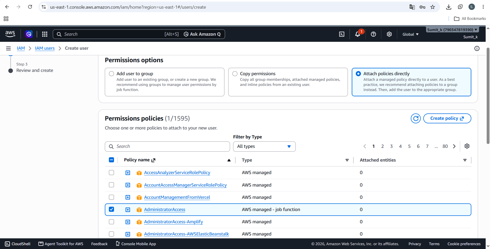
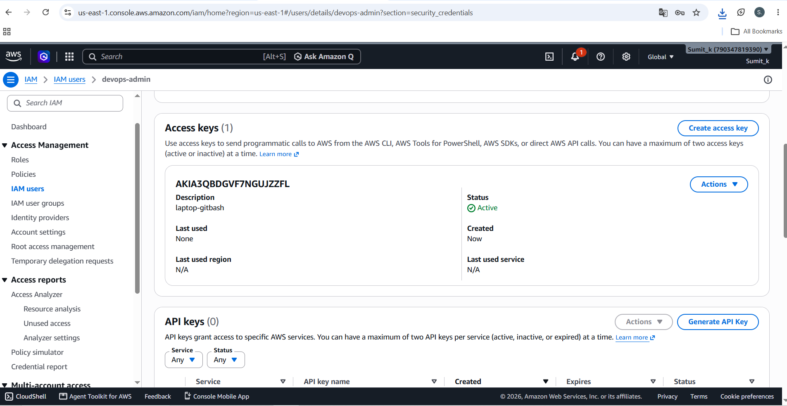
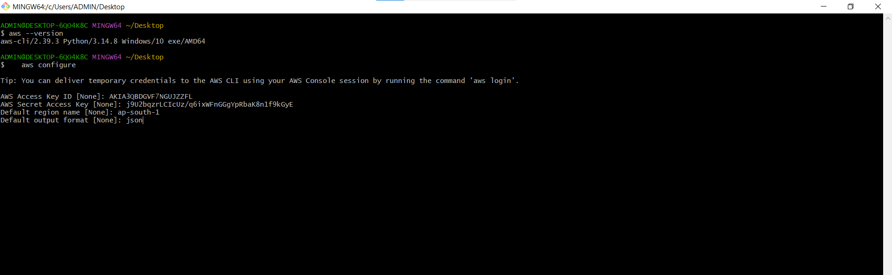
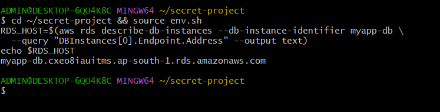
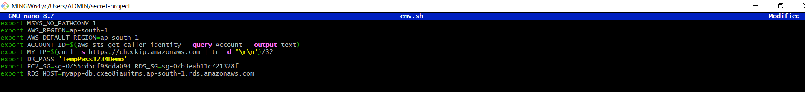
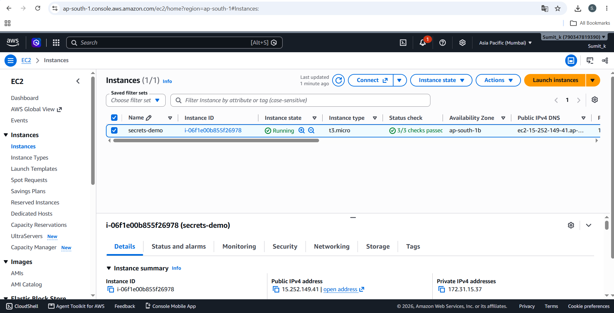
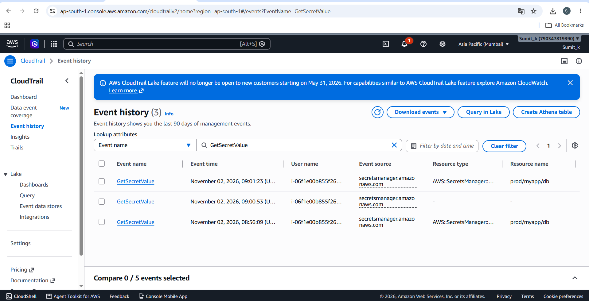
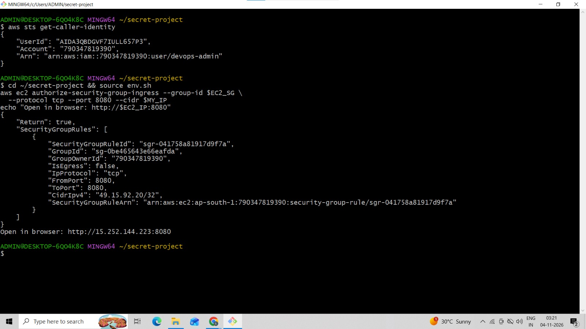
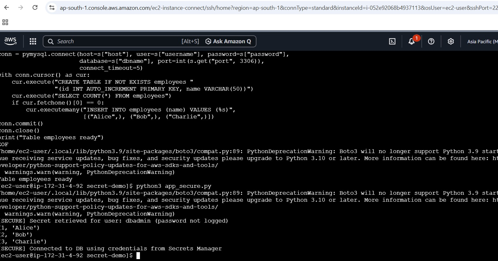
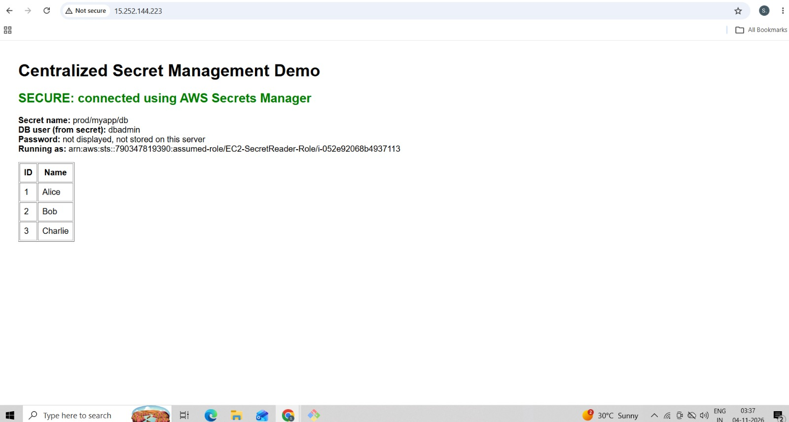

# Centralized Secret Management using AWS Secrets Manager & IAM

## Problem
An internal audit found database passwords hardcoded in application config
files, which exposes them to anyone with repo or server access.

## Solution
- Credentials stored in AWS Secrets Manager (`prod/myapp/db`), encrypted with KMS
- EC2 uses an IAM role (temporary, auto-rotated credentials via IMDSv2)
- The role has least-privilege access to that one secret only
- The app fetches the secret at runtime with boto3; nothing is stored on disk

## Architecture
EC2 (IAM role) -> Secrets Manager -> RDS MySQL (private)

## Repository contents
- app_hardcoded.py / config.ini : insecure baseline (for comparison only)
- app_secure.py                 : secure implementation
- trust-policy.json             : IAM trust policy
- secret-read-policy.json       : IAM least-privilege policy
- screenshots/                  : evidence

## How to run
1. Deploy RDS and EC2 (see deployment steps)
2. Create the secret, create the IAM role, and attach the instance profile
3. `pip3 install boto3 pymysql && python3 app_secure.py`

## Why secret rotation matters
- Limits blast radius: a leaked password is only valid until the next rotation
- Reduces risk from former employees, old backups and logs containing credentials
- Meets compliance requirements (PCI-DSS, ISO 27001, SOC 2)
- Eliminates manual, error-prone password changes
- Because the app reads secrets at runtime, rotation needs no redeploy or downtime

## Security improvements
| Before | After |
|---|---|
| Password in plaintext config file | No credentials in code or on disk |
| Anyone with server or repo access sees the password | Only the specific IAM role can read the secret |
| Static, never-changing password | Rotatable automatically |
| No audit trail | Every access logged in CloudTrail |
| Long-lived access keys risk | Temporary role credentials, no access keys |
| Metadata service open to SSRF (IMDSv1) | IMDSv2 enforced |
| Database publicly reachable | Private RDS, SG-to-SG access only |

### IAM user

### IAM access key

### ADD IAM credential 

### RDS creation

### file 

### check ec2

### event history

### Identity caller check 

### Output on CLI

### Output on webserver

## Cleanup
Delete EC2, RDS, secret, IAM role/instance profile and security groups.